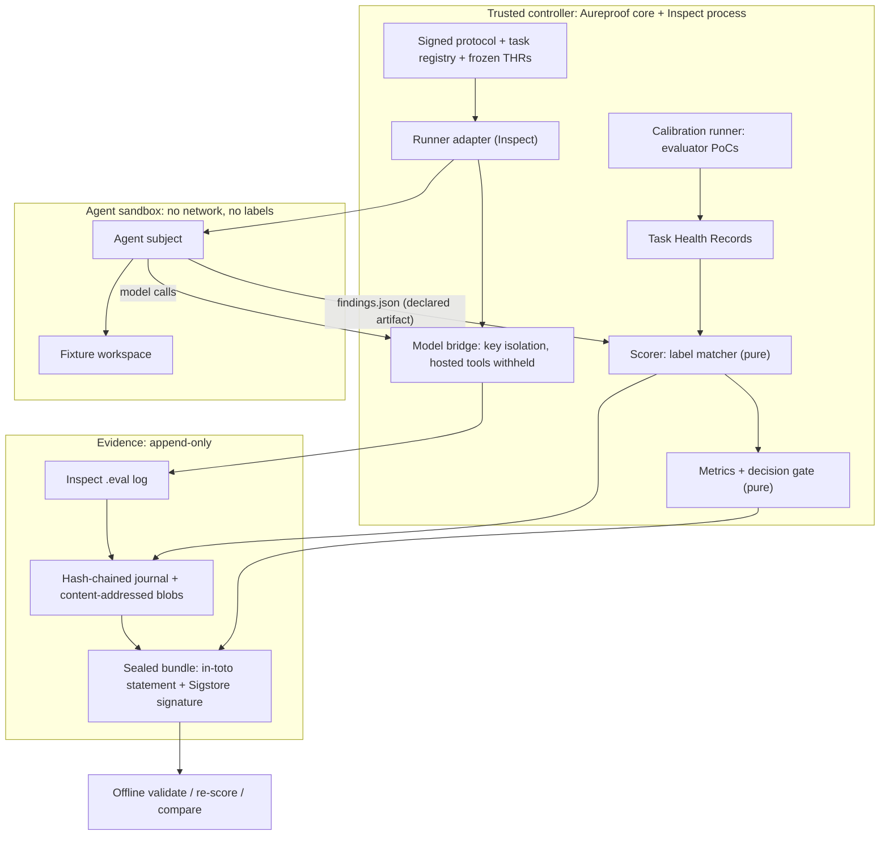

# Aureproof: implementation plan v2

Prepared 6 October 2026. Supersedes the original v1 plan (kept private, not part of this repository) where they differ. The reasoning behind every change is in `plan-review.md`. Appendix A maps each review finding to the section of this document that addresses it.

**Status:** proposed plan. No implementation, benchmark outcome, isolation guarantee, or performance result is asserted. Effort figures are planning assumptions. External facts were verified on 2026-10-06 (§15). Anything still unverified is flagged as a **spike check**.

This is the original design/effort baseline. For implementation progress as of
14 October 2026 and the numbered execution queue, see
[`project-status.md`](project-status.md). The first-12-days table is a proposed
task sequence; it is not a record of completed workdays or a calendar deadline.

---

## 0. What changed from v1

| Area | v1 | v2 | Why |
|---|---|---|---|
| Positioning | Security-agent evaluation platform | **Integrity layer** for agent evaluations (task health + signed evidence + pre-registered decisions) plus a **precision-first** security-discovery benchmark | The verified gap is a layer, not another runner; false alarms are a documented 2026 pain |
| v0.1 oracle | Restricted test target executing submissions | **Deterministic label matcher, a pure function in the trusted controller.** Evaluator-authored calibration PoCs. Agent PoC execution moves to v0.2 | v0.1 findings are not executable; reward files in Harbor are forgeable |
| Runner | Pinned Harbor, which owns retries | **Inspect AI first.** The runner executes single attempts and **Aureproof owns attempt identity and retries**. Harbor returns in v0.2 for separate-verifier PoC execution | Verified Harbor behavior breaks v1's evidence invariants (§3.3) |
| Contracts | Internal typed models | **Three open specs** (Task Health Record, Evidence Bundle, Decision Protocol), each with JSON Schema and conformance vectors | Interoperability and distinctiveness |
| Statistics | Paired intervals, bootstrap | **Exact cluster sign-flip permutation**, non-inferiority three-way gate, MDE from the pilot, sanity and close contrasts | ≤12 clusters makes bootstrap unreliable |
| Fixtures | Textbook vulnerable/repaired pairs | Decoys, cross-file and semantic defects, a **difficulty probe**, canaries, a private assessment split, **spray-and-pray cheat control** | Avoid the ceiling effect and metric gaming |
| Subjects | Build a reference subject and pick an external agent | **Inspect ReAct agent** (or mini-swe-agent) as reference; **Claude Code via `inspect_swe`** as external | Reuse over building; trusted tool observations for the reference subject |
| Standards | Implicit | Explicit adoption map (§8) | Industry alignment |
| OSS | Licence + provenance | Day-1 governance kit, a contribution pipeline, a sequenced upstream plan (§9) | Contribution readiness |
| Policy | Security policy | Responsible use, provider-terms rules, **`safety_refusal` outcome**, disclosure, data ethics (§7) | Compliance |
| Validation | None | **3–5 practitioner interviews in M0**, 2–3 design partners | Demand is unproven |
| Effort | 25–40 days | **40–55 focused days**; the **M2 stop/go is the commitment point** | Bottom-up estimate |

---

## 1. Positioning, users, goals

### 1.1 Positioning
> **Aureproof is an open-source integrity layer for AI-agent evaluations.** On top of the runners teams already use (Inspect first, Harbor next), it certifies three things:
> - the **instrument**: per-task health records
> - the **record**: signed, re-scorable evidence bundles
> - the **decision**: pre-registered pass / fail / inconclusive regression gates
>
> Its flagship benchmark measures whether a security agent's findings are real, **false alarms included**.

**Tagline:** *Every claim, backed by evidence.* "Proof" means reviewable supporting evidence, not formal correctness. Don't claim "first" or "gold standard"; say "to our knowledge" and back it with a cited comparison table.

### 1.2 The v0.1 promise
> Given a versioned security task with a healthy, frozen task-health record, an identified agent system, and a signed pre-registered protocol, Aureproof produces a **signed result bundle**. Another engineer can verify its verdicts, denominators, failures, refusals and evidence, **re-score it offline, and dispute it** through a recorded adjudication path.

### 1.3 Personas and jobs
| Persona | Job to be done | v0.1 feature |
|---|---|---|
| Eval engineer (lab, AISI, platform team) | "Is this regression real, and can I defend the call?" | Decision gate + GitHub Action; signed bundle |
| Security-agent builder | "What's my false-alarm rate on code I control?" | Precision-first fixture pack; spray control; per-category outcomes |
| Benchmark maintainer | "Which of my tasks are broken?" | Task Health Records + `aureproof task validate` |

### 1.4 Documented pain (verified 2026-10-06)
- **curl** ended its bug bounty when the confirmed-report rate fell from "north of 15%" to "below 5%" (Jan 2026) [R26].
- **Bugcrowd** published policy changes against "AI slop" submissions, with queues up more than 334% (Mar 2026) [R27].
- **HackerOne** guidance says report quality is the researcher's responsibility "regardless of whether a human or a tool generated the first draft" (May 2026) [R28].
- **OpenAI** found 59.4% of 138 audited SWE-bench Verified tasks had flawed tests or problem statements (Feb 2026) [R9]. It later found ~30% of SWE-Bench Pro tasks broken and retracted its recommendation (Jul 2026) [R17].
- **promptfoo, Braintrust and LangSmith** gate on thresholds. None reports statistical inconclusiveness [R33].

### 1.5 Goals and non-goals
**v0.1 goals**
- The three specs with a reference implementation.
- A ~20-case precision-first Python fixture pack with health records.
- An Inspect runner adapter.
- One reference and one external subject, plus static and direct-model baselines.
- A signed, offline-re-scorable bundle.
- An exact paired decision gate (CLI + GitHub Action).
- An offline tutorial that needs no credentials.
- An independent reproduction.

**Non-goals (v0.1):**
- a hosted dashboard, Kubernetes, multiple storage backends, a custom scheduler
- broad language coverage, chat, voice, RAG, multi-agent orchestration
- training or fine-tuning
- a universal leaderboard
- executing agent-submitted PoCs
- real-CVE redistribution

### 1.6 Success metrics (6 months after v0.1.0)
- ≥1 external team uses the gate in CI.
- ≥2 merged upstream PRs.
- ≥1 independent reproduction.
- ≥5 issues or PRs from non-maintainers.
- One arXiv report.
- A public-benchmark health audit with upstream-confirmed findings.

NVIDIA ecosystem integrations follow from the upstream plan (§9.4): NeMo Gym and NAT contributions, and an optional NIM-served subject.

### 1.7 Naming
Check PyPI, GitHub, domain and trademark availability for `aureproof` before the public launch (M0). Spec URIs below use `<aureproof-domain>` as a placeholder until that check is done.

---

## 2. Principles

**Kept from v1:**
- Independent grading.
- Grading feedback is withheld during the episode.
- Per-attempt identity.
- Known-defect recall rather than universal recall.
- Explicit unresolved outcomes (unknown ≠ false).
- Scoped negatives.
- Saved effective configuration.
- Repository-aware statistics.
- Separate observation and enforcement coverage.
- The four reproduction operations.
- CLI first.

**New in v2:**
1. **Never read a verdict from a file that untrusted code can write.**
2. **The runner executes; Aureproof owns** identity, attempts, verdicts, adjudications and the seal.
3. **Specs before code; conformance before claims.**
4. **Refusals ≠ misses.** `safety_refusal` is its own outcome.
5. **Reuse upstream, contribute fixes upstream.** Don't fork the ecosystem.
6. **Cheap standards on Day 1, heavy standards on demand** (no governance theater).
7. **Freeze before you look:** task health, exclusions and the protocol are frozen and signed before the assessment.

---

## 3. Architecture

### 3.1 Trust boundaries

This is a trust-boundary diagram, not a deployment requirement. On day one everything in the controller is one local application. Agent execution still needs real isolation. Calibration PoCs are evaluator-authored and run on trusted inputs only.

### 3.2 Ports and adapters
- **Pure core** (no I/O, no network, no clock except injected): `contracts`, `scoring`, `stats`, `bundle`. An import-linter contract in CI enforces this boundary.
- **Adapters** are entry-point plugins, so contributors can extend without forking:
  - `aureproof.runners`: `inspect` (v0.1), `harbor` (v0.2), `docker` (fallback)
  - `aureproof.importers`: `inspect_log`, `sarif`, `harbor_job` (v0.2)
  - `aureproof.exporters`: `eee` (Every Eval Ever, M4), `atif` (pinned, P1), `otel` (opt-in, on demand)
  - `aureproof.oracles`: `label_matcher` (v0.1), `poc_verifier` (v0.2)

### 3.3 Runner strategy
**v0.1: Inspect AI** (verified [R11–R13]):
- `sandbox_agent_bridge()` proxies sandboxed agents' model calls through Inspect (base-URL redirect to a local proxy).
- It **withholds provider-hosted web search, code execution and remote MCP unless the evaluation grants them**.
- Scorers run in the controller.
- `inspect score` re-scores saved logs.
- `stderr(cluster=)` and epochs exist.
- `inspect_swe` provides Claude Code and Codex CLI agents.
- `inspect_harbor` runs Harbor-format tasks inside Inspect [R35].

**Day-2 spike checks** (must pass, or fall back). Result 2026-10-11: checks 1, 3, 4 and 5 pass, and check 2 passes except for the live Claude Code episode. See [`research/spike-inspect-day2.md`](research/spike-inspect-day2.md):
1. The bridge works with the sandbox at `network_mode: none`.
2. The reference subject and Claude Code both write `findings.json` as a declared artifact.
3. The label-matcher scorer runs in the controller and never reads files the agent can write as verdicts.
4. Inspect and `inspect_swe` can be pinned with uv; confirm the Python floor.
5. Attempt control: the runner does single attempts, and Aureproof records retries.

**v0.2: Harbor**, for executing agent PoCs. Verified behavior that dictates the settings [R10, R18–R21]:
| Harbor behavior (v0.24.0) | Required setting |
|---|---|
| The default `shared` verifier lets the agent plant `/logs/verifier/reward.*` (#2551; fix PR #2553 unmerged) | `[verifier] environment_mode = "separate"` on every task |
| In separate mode, a PoC executed by the verifier can still write the reward file (#1779) | Compute the verdict **in-process** (custom `BaseVerifier` returning `VerifierResult`) or outside Harbor; run PoCs as a low-privilege user; kill PoC processes before deciding the verdict |
| Retries `rmtree` the failed attempt directory | `max_retries = 0`; Aureproof schedules and records attempts |
| Real provider keys are forwarded to installed agents; no built-in LLM proxy (#159) | Base-URL override to Aureproof's proxy; `[agent]` egress allowlisted to the proxy only. The install phase is governed separately by `[environment]` |
| PostHog usage telemetry is on by default | `HARBOR_TELEMETRY=off`, recorded in the environment identity |
| `_scrub_jobs_dir()` rewrites trial files after the `on_trial_ended` hook | Hash only after the scrub, or copy out first |
| The artifact manifest has no hashes, and a collection failure doesn't fail the trial | Aureproof hashes on collection; a missing submission is an explicit failure |
| 29 releases Apr–Oct 2026, with breaking changes and docs lagging code | Pin an exact version; contract tests; budget upgrade work |

**Fallback:** a plain-Docker runner (~300 LOC) for synthetic Python fixtures, with its own minimal proxy.

### 3.4 Lifecycle and durable authority
`planned → dispatched → submitted → verified → scored → sealed`

Terminal states are `failed` and `incomplete`, with cleanup bookkeeping. `dispatched` is the runner's single attempt; Aureproof records it and does not mirror the runner's internal state machine.
- Stable IDs are assigned before execution: episode = task × system × protocol × repetition; each attempt gets its own ID.
- **Every scheduled episode ends with exactly one disposition** (§5.5).
- Finalization is idempotent, so duplicate deliveries can't publish duplicate results. Restart recovery is single-host.
- Mandatory-evidence durability:
  1. Persist the request identity before dispatch.
  2. Then retain a response, a terminal error, or an explicit unknown-outcome event.
  3. If mandatory evidence can't be persisted, the episode fails visibly.

### 3.5 Evidence and trust tiers
- The **append-only JSONL journal is authoritative.** Each record carries `seq` and `prev_hash`. SQLite is a rebuildable index.
- Blobs are content-addressed (`sha256`). JSON digests use **RFC 8785** canonical form.
- The seal stores the **event count and journal head hash**. That's what makes tail truncation detectable.
- `observation_source` trust tiers:
  - `controller_observed`: Aureproof or Inspect process records, bridge-proxied model calls, tool calls executed by Inspect into the sandbox.
  - `agent_reported`: an external agent's internal tool calls, ATIF trajectories, agent logs.
  - `imported`: third-party results without trusted execution provenance.
- **Observation coverage** (what we can see) and **enforcement coverage** (what we can constrain) are declared per adapter. Each is backed by a tested capability, not a "trusted" badge.

### 3.6 Inference boundary and fairness
- One provider protocol at first, through the bridge.
- Per-episode budgets: actions, time, tokens where exposed, request count.
- SSE streaming is captured. Proxy-side upstream retries are recorded as **infrastructure attempts**.
- Agent self-repair is an agent action. A hidden continuation is an extra opportunity. All three stay visible.
- Two declared interface modes (kept from v1): **native-capability** and **controlled-interface**. Unsupported capabilities fail preflight; never silently convert them.
- Hosted endpoints: record timestamps and the identity fields the provider returns. Reproduction is limited to the observed endpoint configuration.

### 3.7 Core contracts
| Contract | Key fields | Invariant |
|---|---|---|
| TaskSpec | Task/dataset revision, family, agent view, private label ref, cluster ID, budget requirements, canary ID | The agent view and the labels are separate build contexts |
| SystemSpec | Subject, scaffold, models by role, prompts, tools, memory, policy, adapter revision, runner + version, telemetry settings | Any change yields a new identity |
| DecisionProtocol | See §4.3 | Signed before the assessment |
| EpisodeSpec | Task + system + protocol + repetition | Stable scheduled unit |
| AttemptRecord | Episode, attempt, runner run ID, reason, status, timestamps | Owned by Aureproof; attempts are never silently merged |
| Event | Actor, kind, seq, causal IDs, payload/blob refs, `observation_source` | Agent data can't impersonate controller observations |
| Submission | Tagged union: `findings` (v0.1), `poc_ref` (stored only in v0.1); open to `patch`, `text`, `state` later | Grading uses the sealed final submission |
| Finding / DefectLabel | §5.2–5.3 | SARIF-mappable |
| Verdict | Category, rule ID, matcher version, evidence refs | Unknown or unhealthy is not false |
| TaskHealthRecord | §4.1 | Frozen before the assessment |
| Adjudication | §5.7 | A versioned annotation; never a silent edit |
| MetricRecord | Numerator, denominator, cohort, undefined reasons, metric version | Every percentage has inspectable support |
| Decision | Outcome, interval, margin, test, cluster table | Three-way |
| Bundle manifest + seal | §4.2 | Missing mandatory evidence blocks sealing |

### 3.8 Technology decisions
| Area | Decision | Change trigger |
|---|---|---|
| Language | Python 3.12+ (Harbor requires ≥3.12; Inspect ≥3.10, confirmed in the spike) | Dependency floor changes |
| Contracts | Pydantic v2 + JSON Schema 2020-12 export | — |
| Environment | uv + hash-locked `uv.lock` | — |
| CLI | Typer or similar | — |
| Runner | Inspect (pinned) in v0.1; Harbor (pinned) in v0.2; plain-Docker fallback | Spike failure; v0.2 PoC execution |
| Local metadata | SQLite as a rebuildable index | Multi-host need (measured) |
| Evidence | Hash-chained JSONL + CAS blobs; RFC 8785; in-toto Statement v1; Sigstore | — |
| Analysis | Pure-Python exact tests; optional DuckDB/Parquet export | — |
| Subjects | Inspect ReAct agent or mini-swe-agent (reference); Claude Code via `inspect_swe` (external); Bandit and direct-model baselines | — |
| NVIDIA | `aureproof-nat` evaluator plugin (P1); optional NIM-served subject | Demand |
| Interchange | Every Eval Ever exporter (M4); ATIF import (P1); OTel GenAI opt-in | Demand |
| UI | Markdown/HTML report (all agent strings escaped); GitHub Action PR comment | A real review workflow needs more |
| Licences | Apache-2.0 for code; CC-BY-4.0 for self-authored fixtures | Legal review |

### 3.9 Repository layout
| Path | Responsibility |
|---|---|
| `src/aureproof/{contracts,scoring,stats,bundle}/` | Pure core (import-linted) |
| `src/aureproof/{runners,importers,exporters,oracles}/` | Adapters (entry points) |
| `src/aureproof/cli/` | `validate`, `score`, `report`, `compare`, `gate`, `task validate`, `adjudicate`, `migrate` |
| `specs/{thr,bundle,decision}/` | Normative Markdown + JSON Schema per spec |
| `conformance/` | Spec test vectors (valid and invalid) and the expected outcomes |
| `fixtures/security/<task>/` | Agent-visible fixture material (its own build context) |
| `fixtures/oracles/<task>/` | Evaluator-only labels and calibration PoCs (**never** in an agent build context) |
| Private repo `aureproof-assessment` | Held-out assessment split (canaried) until results are published |
| `examples/bundles/` | Shareable signed tutorial bundles |
| `protocols/` | Signed, pre-registered protocols |
| `rfcs/` | Spec-change proposals (activated with the first external contributor) |
| `docs/{adr,guides,research}/` | ADRs, guides, anonymized interview notes |
| `.github/` | Workflows, templates, CODEOWNERS |
| `LICENSES/` + `REUSE.toml` (or SPDX headers) | REUSE compliance |

A directory named "private" does not create isolation. Build contexts, mounts, process placement and capabilities do.

---

## 4. Open specifications

Each spec ships as normative Markdown, a **JSON Schema 2020-12**, **conformance vectors** under `conformance/`, and the reference implementation. Specs are versioned **independently** of the package. Readers accept the current version and N-1. `aureproof migrate` upgrades artifacts.

### 4.1 Task Health Record (THR) v0.1
**Purpose:** a persistent, machine-readable record that the grader for a task works *in a named environment*. It drives **scoring-time exclusion**, frozen before the assessment.

| Field | Meaning |
|---|---|
| `thr_version`, `task_id`, `task_revision` | Identity |
| `environment` | Runner + version, image digest, platform. Health is **per environment**: Harbor #136 shows an oracle failing on only one backend |
| `controls[]` | `{kind, input_digest, expected, observed, passed, run_ids}` |
| `determinism` | Re-run of every control; identical outcomes required |
| `difficulty_probe` | Bandit (SARIF) result + single-shot model result, with identities |
| `status` | `healthy` (all required controls pass + determinism), `unhealthy` (any required control fails), `unknown` (any control couldn't run) |
| `status_reason`, `known_limits[]` | Human-readable |
| `reviewed_by[]`, `frozen_at` | Review and freeze |
| `canary_id`, `provenance` | Contamination canary; authorship and licence attestation |

**Required controls for findings tasks:**
| Control | Expected |
|---|---|
| `reference_positive` | The label-perfect submission is confirmed for every defect |
| `repaired_negative` | A finding at the focal anchor on the repaired variant is refuted |
| `nop` | An empty submission gives recall 0 |
| `spray_cheat` | A finding at every function with every accepted CWE gets recall ≈ 1 but **strict yield and precision collapse**. If any headline metric rewards it, the metric design is broken |
| `malformed` | Invalid JSON → `invalid_output` |
| `calibration_poc` | The evaluator PoC triggers on the vulnerable variant and not on the repaired variant; irrelevant triggers don't count |

**Exclusion rule:** only THR statuses frozen before the protocol freeze decide exclusion. Post-hoc exclusions are reported as exploratory. An unhealthy task gets a dataset-health status, never an agent false-positive verdict.

### 4.2 Evidence Bundle v0.1
Refined in [`specs/bundle/README.md`](../specs/bundle/README.md), which takes precedence.

```
bundle/
  manifest.json          # RFC 8785 canonical; every member: path, sha256, size, media type, role, mandatory
  protocol.json          # + reference to its Sigstore signature
  system/*.json          # SystemSpecs
  tasks/*.thr.json       # frozen THRs (digests)
  episodes/<episode>/attempts/<attempt>/  # submission, events.jsonl, runner-log reference
  journal.jsonl          # hash-chained (seq, prev_hash)
  adjudications.jsonl    # versioned annotations
  verdicts.json  metrics.json  decision.json
  blobs/sha256/<hex>
  seal.intoto.json       # in-toto Statement v1
  seal.sigstore.json     # Sigstore signature bundle
```
- **Seal:**
  - `subject` = manifest digest.
  - `predicateType` = `https://<aureproof-domain>/attestation/eval-bundle/v0.1`.
  - `predicate` = `{event_count, journal_head, matcher_version, scorer_version, spec_versions, completeness}`.
  - The predicate is aligned with in-toto `test-result/v0.1` [R22]. Track the proposed `eval-result/v0.1` (in-toto PR #575 [R23]) and converge if it merges.
- **Signing:** sigstore-python [R24].
- **`aureproof validate` steps:**
  1. Schemas.
  2. Member digests.
  3. Journal chain, with count and head matching the seal.
  4. Mandatory members present.
  5. Signature verification (when present).
  6. Identity consistency.
  
  Any failure means the result is not valid.
- **Public vs private:** public bundles are redacted, with a declared completeness level; private bundles are complete. They're distinct products.
- A hash proves integrity of recorded bytes, not that the recorded claim is true.

### 4.3 Decision Protocol v0.1
| Field | Content |
|---|---|
| Estimand | Metric (primary: **strict confirmed yield**, ADR-0006), population = the frozen healthy cohort, contrast = B − A, summary = mean of cluster-level differences |
| Cohort and clusters | Task IDs + THR digests; cluster map (vulnerable/repaired variants, templates and repositories grouped) |
| Configurations | SystemSpec digests for A and B; repetitions *n*; budgets |
| Failure handling | How `infra_failure`, `safety_refusal`, `budget_exhausted` and `evidence_incomplete` enter (default: reported separately, scored as non-success for operational completion, excluded from quality metrics) |
| Test | **Exact paired sign-flip permutation** over the *k* clusters (all 2^k assignments); CI by test inversion; Wilson intervals per configuration |
| Decision rule | Margin δ; at level 1−2α: **pass** if CI lower > −δ, **fail** if CI upper < −δ, otherwise **inconclusive** |
| Power floor | With *k* ≤ 5 clusters, the smallest two-sided exact p is 2/2^k ≥ 0.0625, so a decisive result at α = 0.05 is impossible. **≥6 clusters are needed for any decisive outcome.** The MDE from the pilot is recorded |
| Stopping | Fixed *n*, no peeking; exploratory analyses listed in advance |
| Signature | Sigstore-signed; the timestamp must precede the first assessment episode |

---

## 5. Oracle and scoring semantics

### 5.1 v0.1 oracle
`verdicts = match(findings, labels, matcher_version)` is a pure, deterministic function in the controller. It needs no network and no execution, and it never reads reward or verdict files.

### 5.2 Finding schema (SARIF-mappable)
| Field | SARIF 2.1.0 mapping |
|---|---|
| `finding_id` | `result.properties.finding_id` (SARIF `guid` must be a GUID) |
| `cwe` | `result.ruleId = "CWE-<n>"` (+ taxonomy reference) |
| `locations[]{file, start_line, end_line, symbol?, role: source\|sink\|site}` | `physicalLocation.artifactLocation.uri`, `region`, `logicalLocations`; role in `properties` |
| `description` | `message.text` |
| `evidence{explanation, trigger_input?, poc_ref?}` | `properties` (`poc_ref` is a blob digest; stored, not executed in v0.1) |

### 5.3 Defect labels (evaluator-only)
`defect_id`, `variant` (vulnerable/repaired), `accepted_cwes[]` (e.g. {78, 77, 88}), `anchors[]{file, symbol, line_range, role}`, `cluster_id`, `reviewed_negative_scope[]`, `calibration_poc_ref`.

### 5.4 Matching rules (proposal; refined in [`specs/scoring/scoring.md`](../specs/scoring/scoring.md), which takes precedence)
| Rule | Behavior |
|---|---|
| M1 location | Same file, and either the symbol matches or the line ranges overlap within tolerance *t* (default proposed: ±3 lines) |
| M2 role | Cross-file flows: matching either the source or the sink anchor counts, unless the label requires a role |
| M3 class | CWE ∈ `accepted_cwes`. A location match with the wrong class → `unresolved:class_mismatch` (goes to adjudication) |
| M4 duplicates | Several findings on one defect → the first in submission order is `confirmed`, the rest are `duplicate` |
| M5 one→many | A finding matching two defects is credited to the best match (symbol > line overlap); the other defect stays unfound |
| M6 repaired | A finding at the focal anchor on the repaired variant → `refuted` |
| M7 negative scope | A finding entirely inside reviewed-negative scope → `refuted` |
| M8 out of scope | Everything else → `unresolved:out_of_scope` (adjudication queue) |
| M9 invalid | A schema-invalid finding → `invalid`; an invalid whole output → episode `invalid_output` |

### 5.5 Outcomes
- **Finding verdicts:** `confirmed`, `refuted`, `duplicate`, `unresolved:{class_mismatch,out_of_scope}`, `invalid`.
- **Episode dispositions (exactly one each):** `completed_with_findings`, `completed_no_findings`, `invalid_output`, `safety_refusal`, `budget_exhausted`, `agent_error`, `infra_failure`, `evidence_incomplete`.
- **Refusals are never misses**, and they are never retried away. Provider cyber safeguards can refuse legitimate work [R31].

### 5.6 Metrics
| Metric | Definition |
|---|---|
| Known-defect recall | Labeled positives found / scoped positives. Not universal recall |
| Adjudicated precision | confirmed / (confirmed + refuted), with the unresolved fraction shown alongside. Undefined when the denominator is 0 |
| Strict confirmed yield | confirmed / all submitted findings (duplicates, invalid and unresolved stay in the denominator) |
| Scoped false-alarm rate | Refuted findings per reviewed-negative unit |
| Duplicate rate | duplicate / submitted |
| Operational completion | Completed dispositions / scheduled episodes |
| Refusal rate | `safety_refusal` / scheduled episodes, per system |
| Budget usage | Actions, time, tokens, requests (visible; not normalized across tokenizers) |

### 5.7 Adjudication
- **Queue:** all `unresolved` findings.
- **Record:** `{finding_id, adjudicator, decision: confirmed|refuted|label_change, rationale, evidence_refs, timestamp, dataset_revision_before/after}`.
- **Two adjudicators on ≥20% of cases**, with Cohen's κ reported. Disagreements are resolved and recorded.
- A real defect found in a "negative" region produces a **new dataset revision**. Prior results are re-scored under both revisions, and nothing is edited silently.
- Offline re-scoring reuses saved adjudications. Re-adjudicating is a new grading operation.

### 5.8 Golden examples (≥15; written before the matcher)
1. Exact anchor + accepted CWE → confirmed.
2. Symbol match, lines off by 10 → confirmed.
3. Within line tolerance, no symbol → confirmed.
4. Right location, wrong class → unresolved:class_mismatch.
5. Two findings on one defect → confirmed + duplicate.
6. One finding spanning two defects → one confirmed, one unfound.
7. Finding at the repaired focal anchor → refuted.
8. Finding in reviewed-negative scope → refuted.
9. Finding outside reviewed scope → unresolved:out_of_scope.
10. Cross-file finding at the source only → confirmed.
11. Alternate accepted CWE (77 for a 78 label) → confirmed.
12. Empty list → completed_no_findings; precision undefined.
13. Malformed JSON → invalid_output.
14. Refusal with no findings → safety_refusal.
15. Infrastructure failure → infra_failure.
16. Missing mandatory evidence → evidence_incomplete; can't seal.
17. Truncated journal → validation fails.
18. Spray submission → recall ≈ 1, yield ≈ 0.

### 5.9 Four reproduction operations (kept from v1)
| Operation | Establishes | Live inference? |
|---|---|---|
| Bundle validation | Files, identities, digests, signature | No |
| Offline re-score | The same saved verdicts and adjudications produce the same metrics | No |
| Executable re-verification | A saved submission re-run through the pinned oracle (v0.2 for PoCs) | Usually no |
| Fresh subject rerun | Behavior of a newly executed subject | Yes |

---

## 6. Statistics, pilot, and demonstration

### 6.1 Clusters and design
- Group vulnerable/repaired variants, template families and repositories into clusters. Count independent clusters conservatively.
- The fixture pack target is ~20 cases, which is a scope target, not a sample size. Aim for **≥8 clusters**: more clusters beat more repetitions.

### 6.2 Pilot
- Six cases × 2 configurations × 3 repetitions = **36 episodes**.
- Use it to estimate variance and the **MDE** and to find harness and oracle defects. Fix those under new versions and keep the prior records.
- If the MDE exceeds any practically interesting effect, the primary claim becomes **descriptive only**, and the plan says so.

### 6.3 Assessment
- Episodes = 20 × 2 × *n* agent episodes, plus separately accounted baselines.
- Report:
  - counts and denominators
  - unresolved coverage
  - dispositions
  - refusal rates
  - per-cluster differences
  - exact CI
  - the three-way decision with its rationale

### 6.4 Two contrasts (demo design)
- **(a) Sanity contrast:** a large expected effect, e.g. full file tools vs. no file tools, or a tiny vs. normal budget. It should be **decisive**, which demonstrates the gate has power.
- **(b) Realistic close contrast:** e.g. a prompt variant. It is likely **inconclusive**, which demonstrates the gate refuses unsupported claims.

### 6.5 Claims discipline
- Separate uncertainty over repeated runs on this suite from generalization to future repositories. Make no population claims from synthetic fixtures.
- Selecting the best of many prompts on the assessment suite invalidates an unadjusted "winner" claim.
- Exploratory slices are labeled as such.

### 6.6 CI semantics
- **Routine CI (offline, free):** schemas, conformance vectors, the golden table, THR controls, fault tests.
- **Live assessment:** separately authorized and budgeted.
- No live model calls on CI runs from forks.
- **Gate outcomes:** pass / fail / inconclusive. Low power or incomplete adjudication never becomes "pass".

### 6.7 v0.1 demonstration script
1. Cohort and frozen, signed protocol.
2. The primary metric in plain language.
3. Sanity contrast (decisive) and close contrast (inconclusive), with exact intervals.
4. Follow one surprising finding to controller-observed evidence.
5. A THR's controls, including the spray-cheat control.
6. Offline re-score, plus a stranger verifying the signature.
7. A restart with no duplicate publication.
8. One limitation, one changed assumption, one upstream PR.

---

## 7. Threat model, security, and policy

### 7.1 STRIDE summary (v0.1). Every control has a test.
Maintained, with test IDs and status, in [`threat-model.md`](threat-model.md) (AP-002).

| Threat | Example | Control | Test |
|---|---|---|---|
| Spoofing | Agent output claims to be a verifier event | Agent data is tagged `agent_reported`; only the controller writes trusted events | Inject a fake verifier event → it stays `agent_reported` |
| Tampering | Agent writes a fake reward or verdict file | Verdict computed in the controller from the parsed artifact; no reward files are read | A planted reward file is ignored |
| Tampering | Bundle edited after the seal | Digests + journal chain + signature | Flip one byte → validation fails |
| Repudiation | "Which protocol produced this?" | Signed protocol and bundle; attempt records | Signature identities verify |
| Info disclosure | Agent reads labels | Labels never in the agent build context; canaries in oracle files | Canary search in the workspace and transcripts finds nothing |
| Info disclosure | Provider keys in the sandbox | Bridge proxy; no upstream keys in the sandbox environment | Sandbox env dump shows no keys |
| Info disclosure | Secrets in published bundles | Secret scan + redaction check | A planted fake key is caught |
| DoS | Hostile `findings.json` | Size, depth and count limits; canonical paths; reject symlinks | 100 MB file, `../` path, symlink, deep nesting |
| DoS | Runaway episode | Time, action and token budgets | Exhaustion → `budget_exhausted` |
| Elevation | Network egress from the sandbox | `network_mode: none` (spike check) | Outbound attempt fails |
| Elevation | Hosted tools bypass the sandbox | Withheld unless granted | A request with hosted tools is withheld or rejected |
| Injection | Agent HTML in the report | Escape every agent string | A `<script>` payload renders inert |

Use one Linux evaluation host. Docker alone is not claimed to be a hardened boundary for arbitrary hostile code; the tested controls are what's claimed. Docker Desktop on macOS is for development only, and its egress enforcement is unverified.

### 7.2 v0.2 additions (executed PoCs)
- Harbor separate verifier with an in-process verdict.
- Low-privilege PoC user; kill processes before the verdict.
- A missing PoC artifact = failure.
- Fresh restricted target per submission.
- Cross-trial canaries.

### 7.3 Responsible use and authorization (`RESPONSIBLE_USE.md`)
- Targets are **self-authored or explicitly authorized** only. Anthropic's AUP prohibits discovering or exploiting vulnerabilities "without authorization" [R29].
- No fixtures point at third-party live systems. Sandboxes have no network.
- v0.1 is synthetic-only. In v0.2, real-CVE PoCs come only from already-public upstream benchmarks, are stored in restricted bundles, and are summarized (not shipped as working exploits) for unpatched issues in public reports.
- Check GitHub's Acceptable Use Policies on exploit content before publishing anything beyond synthetic fixtures.

### 7.4 Provider-terms rules
- **Evaluation only, not for training.** Anthropic's commercial terms and OpenAI's Services Agreement §3.3 prohibit using outputs to build competing models [R29, R30]. The dataset card states "evaluation only; not for training", and transcripts carry canaries.
- **No provider names as endorsement or logos.** OpenAI's agreement restricts using its name or logo, so models are only named factually.
- **Never retry to bypass safeguards** (OpenAI §3.3). Record `safety_refusal`.
- **Read OpenAI's Sharing & Publication Policy** before the first public results. Its content is *unverified*. Check any additional provider's terms (e.g. NIM) before use.

### 7.5 Disclosure
- `SECURITY.md` + **GitHub private vulnerability reporting** [R38].
- Proposed targets: acknowledgement in 7 days; coordinated fix and disclosure in 90 days.
- If an agent surfaces a real vulnerability in third-party code (v0.2+), report it privately to that maintainer and don't publish until it's fixed.

### 7.6 Data ethics and contamination
- Canary GUIDs in every fixture and oracle file.
- The held-out assessment split stays in a private repo until results publish.
- Croissant RAI fields.
- No personal data.
- Track public exposure and benchmark overlap. Don't call syntactic renaming a contamination cure.

### 7.7 Secrets and privacy
- Secret scanning (e.g. gitleaks) in CI and on bundles before publication.
- `HARBOR_TELEMETRY=off` in v0.2.
- Provider logging settings are recorded.
- No credentials in bundles.

---

## 8. Standards adoption map (versions verified 2026-10-06)

| Concern | Standard | When | Effort |
|---|---|---|---|
| Findings | SARIF 2.1.0 + Errata 01 (OASIS) [R39]; Bandit `-f sarif` via `bandit[sarif]` [R14] | M1/M2 | S |
| Taxonomy | CWE IDs and accepted-CWE sets | M1 | S |
| Schemas | JSON Schema 2020-12 | M1 | S |
| Digests | RFC 8785 + SHA-256 | M1 | S |
| Attestation | in-toto Statement v1 + DSSE; predicate aligned to `test-result/v0.1`; track PR #575 [R22, R23] | M1 seal, M2 signing | M |
| Signing | Sigstore (sigstore-python 4.5.0) [R24] | M2 | S |
| Release provenance | PyPI Trusted Publishing + PEP 740 attestations (Final; default in the PyPA action) [R25]; `actions/attest` (SLSA v1) | Day 1 config, M1 first upload | S |
| Supply chain | OpenSSF Scorecard v5.5.0, target ≥ 8 [R36] | Day 1 | S |
| Project hygiene | OpenSSF Best Practices badge (Passing → Baseline) [R36] | M4 | S |
| Licensing | SPDX + REUSE 3.3 (`reuse lint`) [R40] | Day 1 | S |
| SBOM | CycloneDX or SPDX | M4 | S |
| Citation | CITATION.cff + Zenodo DOI (no `.zenodo.json`, which would override it) [R41] | Day 1 / M4 | S |
| Dataset metadata | Croissant 1.1 + RAI 1.0 (required by the NeurIPS 2026 Evaluations & Datasets track) [R42] | M4 | M |
| Eval interchange | Every Eval Ever 0.3.0, pinned (pre-1.0) [R34] | M4 | M |
| Telemetry | OTel GenAI semconv (Development status) [R43] | On demand, opt-in | M |
| Trajectories | ATIF v1.7/v1.8, pinned `schema_version`, imported as `agent_reported` [R21] | P1 | S |
| Benchmark rigor | ABC self-assessment [R32]; BetterBench assessment request [R37] | M4 | S |
| Change management | SemVer (0.x), Keep a Changelog, Conventional Commits | Day 1 | S |
| Statistics reporting | Clustered and paired reporting per Miller 2024 [R44], plus exact small-cluster tests | M1/M3 | S |

---

## 9. Open-source governance and contribution model

### 9.1 Day-1 kit (hours of template work)
- `LICENSE` (Apache-2.0), `LICENSES/`, `REUSE.toml`, `NOTICE`.
- `README` (scope, limits, comparison table with citations).
- `CONTRIBUTING`:
  - DCO 1.1 sign-off (`git commit -s`) [R38]
  - dev setup
  - test commands
  - **AI-assistance disclosure** (below)
- `CODE_OF_CONDUCT` (Contributor Covenant 3.0) [R38].
- `SECURITY.md` + private vulnerability reporting enabled.
- `RESPONSIBLE_USE.md`.
- `CITATION.cff`, `CHANGELOG.md`, `ROADMAP.md`.
- Issue and PR templates.
- `CODEOWNERS`.
- CI:
  - tests, ruff, type checks, import-linter
  - `reuse lint`, secret scan
  - Scorecard
  - actions pinned by SHA, least-privilege tokens
  - Dependabot/Renovate
  - CodeQL or Semgrep (SAST)

### 9.2 On demand (activate when triggered)
| Item | Trigger |
|---|---|
| `GOVERNANCE.md` maintainer ladder, `MAINTAINERS` | First regular external contributor |
| `rfcs/` process for spec changes | First external spec proposal |
| Docs site | v0.1.0 or the first adopter request |
| Croissant card, EEE exporter | M4 |
| OTel exporter | Adopter request |

### 9.3 Contribution flows
- **Code:** a PR with DCO sign-off; CI green; one maintainer review. Spec-affecting changes go through an RFC once that process is active.
- **Fixtures:**
  1. Copy the fixture template.
  2. `aureproof task validate` runs in CI: all THR controls, determinism, canary present, authorship and licence attestation.
  3. Reviewer rubric adapted from Terminal-Bench's `REVIEWING.md` [R20].
  4. A held-out variant may go to the private split.
- **AI-assisted contributions:**
  - Disclose substantial AI assistance in the PR.
  - The submitter is responsible for correctness, licensing and having run the tests.
  - Maintainers may close unverifiable submissions.
  - This mirrors HackerOne's responsibility norm and fits the project's own subject.
- Labels: `good first issue`, `help wanted`, `spec`, `adapter`, `fixture`. Target: ≥10 good-first issues at v0.1.0.

### 9.4 Upstream plan (sequenced; coordinate first, never compete)
| # | Venue | Contribution | Requirements (verified) |
|---|---|---|---|
| 1 | NVIDIA NeMo Gym PR #3675 (draft: oracle agent + `gym dataset validate`) [R19] | Build on it: nop and cheat controls, THR export. Talk to the PR author first | DCO sign-off on every commit; Apache-2.0 headers |
| 2 | in-toto attestation PR #575 (eval-result predicate) [R23] | Field requirements from Aureproof bundles | — |
| 3 | Every Eval Ever [R34] | Exporter; propose optional task-health and decision fields | Pin 0.3.0 |
| 4 | Harbor | Publish the fixture pack (`harbor publish --public`, after oracle/nop pass) [R20]; task-health metadata (#136 as motivation); regression tests for #2551/#1779 via normal issues | Registry adapters need a 100% oracle pass and parity runs |
| 5 | inspect_evals Register [R45] | Register the benchmark **after** an arXiv report exists | Paper URL, 40-char pinned SHA, logs from two models; new eval code PRs are no longer accepted |
| 6 | NVIDIA NAT [R15] | `aureproof-nat` evaluator plugin (`@register_evaluator`, `BaseEvaluator.evaluate_item`) | Pin NAT 1.8 docs |

### 9.5 Release process
- SemVer 0.x for the package; specs versioned separately; CHANGELOG.
- GitHub Actions release with **Trusted Publishing** (PEP 740 attestations by default) and an SBOM.
- Zenodo DOI from GitHub releases.
- Signed example bundles.

---

## 10. Roadmap

### 10.1 Milestones (focused days, cumulative)
| Milestone | Days | Scope | Exit demo / gate | Kill / pivot |
|---|---|---|---|---|
| **M0 Foundations** | 5–6 | 3–5 practitioner interviews (one-page positioning + mock report); ADR-001…005; Day-1 OSS kit + CI; worked example (pair #1); Inspect spike; namespace check; Linux VM | Interview notes; fresh clone green in under 10 min; spike verdict | No pull for task health or gating → narrow to benchmark + report. Bridge can't isolate keys → Docker runner + own proxy |
| **M1 Offline integrity core** | 12–16 | Draft specs (THR, Bundle, Decision) + schemas + conformance vectors; `scoring.md` + golden table; matcher + metrics; RFC 8785, hash chain, in-toto seal; CLI `validate/score/report`; STRIDE matrix; `0.1.0a1` via Trusted Publishing | **Phase-1 gate:** golden bundle counts match an independent calculation exactly; offline only; malformed or incomplete evidence can't seal | Counts disagree → stop, fix the spec |
| **M2 Calibrated slice** | 20–26 | 3 pairs with full THR controls; difficulty probe; reference subject live via the bridge; Sigstore-signed bundle; offline re-score; stats on synthetic records | **Stop/go (commitment point):** one live episode linked protocol → model calls → submission → controller verdict → signed bundle → identical offline re-score | Baselines saturate the pairs → redesign fixtures. No isolated oracle → no live expansion |
| **M3 Benchmark + gate** | 30–38 | ~20 cases (decoys, cross-file, semantic) with reviewer, adjudication, canaries, private split; Claude Code via `inspect_swe`; baselines; exact gate + GitHub Action; pilot (36 episodes); **signed pre-registered protocol** | Signed protocol predates the assessment; pilot report with MDE | MDE too large → descriptive claim only |
| **M4 v0.1.0** | 36–46 | Assessment (sanity + close contrasts); report; ABC self-assessment; 3 guides; Croissant card; EEE exporter; fault qualification (restart, interrupted call, duplicate finalization, partial write); SBOM, PEP 740, DOI; independent reproduction | All §14 criteria pass | Reproduction fails → no release |
| **M5 Upstream & audit** (overlaps M3+) | +5–8 | §9.4 items 1–4; public-benchmark THR audit; arXiv report → item 5 | ≥2 upstream PRs merged or under active review | — |

**Effort:**
- **~40–55 focused days**, including buffer.
- At ~6 productive hours per focused day, that's ~240–330 hours.
- Calendar time depends on availability. This is an estimate, not a commitment. The M2 stop/go is the real commitment point.

### 10.2 Beyond v0.1
- **v0.2 (real reproduction):**
  - Start from CyberGym's 10-task subset (clarify the dataset terms first: no licence tag; ~240 GB data, ~10 TB with images) or a small SEC-bench slice (MIT; >200 GB disk; per-instance images).
  - Preserve upstream information modes (SEC-bench `poc-repo`/`poc-desc`/`poc-san`; CyberGym L0–L3).
  - Harbor separate verifier per §3.3; executed agent PoCs; executable re-verification.
  - `aureproof-nat`.
  - SEC-bench Pro is out of scope until KVM hosting is planned.
- **v0.3:** trusted patch grading (fix + behavior-preservation tests from the evaluator, forbidden-path checks) and a bounded injection overlay. Utility, exposure, attempt, blocking and realized effect are each scored separately.
- **v0.4+ (contributor-led):** stateful chat with scripted users, resettable state, policy invariants and world-state oracles, reusing τ²/τ³-bench ideas.
- **Not scheduled:** RAG, voice, arbitrary multi-agent systems, training.

---

## 11. Backlog v2

Priority: **P0** = critical path to v0.1.0; **P1** = v0.1.x; **P2** = later. v1 IDs are kept for traceability.

| ID | M | Pri | Item | Depends | Done when |
|---|---|---|---|---|---|
| AP-001 | M0 | P0 | Scope: personas, goal, non-goals, primary metric, agent + protocol choice (ADR-001/004/005) | — | `scope.md` + ADRs merged |
| AP-032 | M0 | P0 | Practitioner interviews (3–5) with one-page positioning + mock report | AP-001 draft | Anonymized notes in `docs/research/`; go/narrow decision recorded |
| AP-033 | M0 | P0 | Day-1 OSS kit + hardened CI (§9.1) | — | Scorecard runs; `reuse lint` and secret scan green |
| AP-034 | M0 | P0 | Inspect spike (§3.3 checks) → ADR-002/003 | AP-010 draft | All 5 checks pass, or a fallback is chosen |
| AP-010 | M0→M2 | P0 | Pair #1: fixture, labels, calibration PoC, expected-verdict table | — | Phase-0 scenarios are describable without running code |
| AP-005 | M1 | P0 | `scoring.md`: matching rules M1–M9, dispositions, metrics, golden table (§5.8) | AP-001 | A reviewer agrees with every golden outcome |
| AP-003 | M1 | P0 | TaskSpec/SystemSpec/EpisodeSpec/AttemptRecord schemas | AP-001 | Valid and invalid vectors pass |
| AP-004 | M1 | P0 | Event/Submission (findings, poc_ref)/Finding/Verdict schemas, SARIF mapping | **AP-005**, AP-003 | Vectors + SARIF round-trip |
| AP-035 | M1 | P0 | THR spec + schema + conformance vectors | AP-005 | Vectors cover healthy, unhealthy and unknown |
| AP-036 | M1→M2 | P0 | Bundle spec: RFC 8785, hash chain, in-toto seal; Sigstore signing in M2 | AP-004 | Tamper, truncate and missing-member vectors fail validation |
| AP-037 | M1→M3 | P0 | Decision Protocol spec + exact permutation gate; GitHub Action in M3 | AP-005 | Exact p and CI match enumeration on synthetic data |
| AP-006 | M1 | P0 | Blob store + bundle validation | AP-036 | Altered or missing blobs fail |
| AP-007 | M1 | P0 | Matcher + metrics (pure, test-first, Hypothesis invariants) | AP-004, AP-005 | Golden table green; invariants hold |
| AP-008 | M1 | P0 | CLI `validate/score/report` (escaped HTML) | AP-006, AP-007 | Offline tutorial runs without credentials |
| AP-002 | M1 | P0 | STRIDE threat model + control→test matrix (§7.1) | AP-034 | Every control has a test ID |
| AP-040 | M1→M4 | P1 | Spec versioning policy (M1) + `aureproof migrate` (M4) | AP-035/036/037 | N-1 vectors validate |
| AP-041 | M0→M1 | P0 | `RESPONSIBLE_USE.md`, provider-terms rules, `safety_refusal` disposition | AP-001 | Docs merged; refusal vector scores correctly |
| AP-009 | M1→M2 | P0 | Aureproof-owned attempts + journal for owned stages; restart recovery | AP-036 | Restart preserves IDs; finalization is idempotent |
| AP-011 | M2 | P0 | Calibration runner + THR controls for pair #1 (incl. nop, spray_cheat) | AP-010, AP-035 | THR `healthy` with a determinism re-run |
| AP-012 | M2 | P0 | Inspect runner adapter (single attempts; `findings.json` artifact) | AP-034, AP-009 | A live episode produces a submission + log |
| AP-013a | M2 | P0 | Artifact parsing limits (size, depth, paths, symlinks) | AP-012 | DoS vectors are rejected |
| AP-015 | M2 | P0 | Bridge capability tests (key isolation, hosted tools withheld, budgets) | AP-012 | Env-dump and hosted-tool tests pass |
| AP-016 | M2 | P0 | Reference subject (Inspect ReAct or mini-swe-agent) | AP-012 | Controller-observed tool events present |
| AP-014 | M2 | P0 | Pairs #2–3 (path boundary, missing authz) with THRs | AP-011 | All `healthy` |
| AP-019 | M2→M3 | P0 | Bandit SARIF + direct-model baselines; difficulty probe in THR | AP-004, AP-011 | Probe results recorded; saturation flagged |
| AP-039 | M2→M3 | P0 | Canaries + private assessment split | AP-010 | Canary scan in CI; private repo exists |
| AP-017 | M3 | P0 | External subject: Claude Code via `inspect_swe` | AP-012, AP-015 | Coverage declaration + version pin documented |
| AP-018 | M3 | P0 | Fixture pack to ~20 (decoys, cross-file, semantic) with reviewer | AP-014, AP-039 | ≥8 clusters; all THRs frozen |
| AP-038 | M3 | P0 | Adjudication workflow + `aureproof adjudicate` + κ | AP-007 | Record schema + κ report |
| AP-020 | M3 | P0 | Paired comparison report (per-cluster table, exact CI, Wilson) | AP-037 | Designed dependent-data vectors pass |
| AP-021 | M3 | P0 | Pilot (36 episodes) → MDE → **signed protocol** | AP-017–020 | Signature timestamp precedes the assessment |
| AP-022 | M4 | P0 | Assessment (sanity + close contrasts) + report | AP-021 | Every episode has a disposition; three-way decision with rationale |
| AP-023 | M4 | P0 | Fault qualification (restart, interrupted call, duplicate finalization, partial write) | AP-009 | No duplicate score or false seal |
| AP-024 | M4 | P0 | Docs (tutorial, task authoring, interpretation), provenance, SBOM, PEP 740, DOI | AP-008, AP-017 | Clean offline install; terms checked |
| AP-044 | M4 | P0 | ABC self-assessment (+ BetterBench request) | AP-022 | `docs/ABC.md` published |
| AP-025 | M4 | P0 | Independent reproduction + verdict review | AP-022, AP-024 | Reproduced table; disagreements recorded |
| AP-042 | M4 | P1 | Every Eval Ever exporter | AP-022 | Round-trip test |
| AP-043 | M4 | P1 | Croissant 1.1 + RAI card for the fixture pack | AP-018 | Validator passes |
| AP-045 | M5 | P1 | Public-benchmark THR audit + upstream reports | AP-035 | Findings filed; ≥1 confirmed upstream |
| AP-046 | M5 | P1 | Upstream: NeMo Gym #3675, in-toto #575, EEE fields, Harbor registry | AP-045 | ≥2 PRs merged or under active review |
| AP-047 | M5 | P1 | arXiv report → inspect_evals Register | AP-022 | Register issue opened |
| AP-026 | — | P1 | ATIF import (pinned; `agent_reported`) | AP-004 | Round-trip reports losses |
| AP-027 | — | P1 | `aureproof-nat` evaluator plugin | AP-007 | Compatibility fixture against NAT 1.8 |
| AP-012H | v0.2 | P2 | Harbor runner with the §3.3 settings | AP-012 | Forgery regression tests pass |
| AP-013b | v0.2 | P2 | Executed-PoC confinement | AP-012H | Reward-forgery and escape tests pass |
| AP-028 | v0.2 | P2 | Real-world subset audit (terms, footprint, oracle health) | AP-025 | Inclusion criteria + THRs recorded |
| AP-029/030/031 | v0.3+ | P2 | Patch grading; injection overlay; scripted chat contract | — | As in v1 |

---

## 12. First 12 days

**Day-1 checklist**
- [ ] ADR-001 (goal and scope), ADR-004 (oracle = label matcher + calibration PoCs) and ADR-005 (reviewer) drafted. ADR-002/003 (runner, attempt ownership) come from the Day-2 spike.
- [ ] Second reviewer named, with a review cadence agreed.
- [ ] Interviews scheduled (3–5).
- [ ] Linux VM provisioned (Docker + nftables).
- [ ] Repo + Day-1 OSS kit + CI green.
- [ ] Namespace check.
- [ ] First 15 issues filed, each with a definition of done, estimate, dependency and labels.

| Day | Work | Exit artifact |
|---|---|---|
| 1 | Repo, uv, CI, OSS kit; `scope.md`; draft pair #1 + labels + calibration PoC | Repo + worked example |
| 2 | **Inspect spike** (§3.3, 5 checks) | ADR-002/003 |
| 3 | `scoring.md` + golden table; THR outline; STRIDE; `protocol-v0.yaml` | Frozen semantics |
| 4 | Contracts + JSON Schemas + conformance vectors (findings only, SARIF mapping) | Schemas |
| 5 | Matcher + metrics, test-first with Hypothesis | Exact counts |
| 6 | RFC 8785, CAS blobs, hash chain, in-toto seal | Integrity vectors |
| 7 | CLI `validate/score --offline/report`; `0.1.0a1` via Trusted Publishing | **Phase-1 gate** |
| 8 | THR controls for pair #1 (incl. nop, spray_cheat, calibration PoC) | First THR |
| 9 | Bandit SARIF + single-shot baseline (difficulty probe) | Probe |
| 10–12 | Live episode via the bridge → `.eval` → Sigstore-signed bundle → offline re-score | **Vertical slice** |

If Day 12 doesn't show an isolated, calibrated oracle and a signed, re-scorable bundle, repeat the gate. Don't compensate by adding frameworks or dashboards.

---

## 13. Risk register

| Risk | Early signal | Response |
|---|---|---|
| Scope grows faster than evidence quality | More adapters than healthy tasks | Freeze expansion until the gate passes; no P0 added without one removed |
| Oracle mistakes dominate | Reference-positive failure; vulnerable/fixed parity | Mark the task unhealthy; audit under a new revision |
| **Ceiling effect** | Bandit and the single-shot baseline saturate the pairs | Redesign: decoys, cross-file, semantic defects |
| **Metric gaming (spray)** | The spray control scores well on a headline metric | Fix the metric design before any assessment |
| **Refusal skew** | Refusal rate differs by system | Report `safety_refusal` separately; never retry to bypass |
| External adapter hides activity | Missing controller-observed events | Publish partial coverage, or choose a better-supported subject |
| Provider abstraction distorts fairness | Silent transformations | Native vs controlled-interface modes; disclose transformations |
| Contamination | Public exposure of fixtures | Canaries, private split; restrict claims |
| Synthetic fixtures inflate confidence | High success, few mechanisms | Fixed-suite limits; more clusters before broad claims |
| Unresolved cases bias rankings | Unequal adjudication coverage | Show coverage; hold the decision inconclusive |
| Runtime can't enforce restrictions | Canary or egress succeeds | Block live untrusted evaluation; change backend |
| **Runner churn** (Inspect/Harbor) | Breaking upgrades | Exact pins, contract tests, thin adapters |
| **Thin moat / upstream absorption** | NeMo Gym, in-toto or EEE ship overlapping features | Contribute upstream; differentiate on execution quality and integration |
| **Governance theater** | More policy files than users | Heavy items stay on demand (§9.2) |
| Evidence costs overwhelm the workflow | Huge logs, slow review | Payload caps, blob references; keep mandatory data |
| Solo maintenance | Many version-specific failures | Small compatibility matrix; optional adapters; seek co-maintainers via design partners |
| Little adoption | Users can't integrate their own logs | Importers + GitHub Action; design partners |
| **Provider terms change** | Policy updates | Re-check terms before each public release |
| Branding overpromises | "Proof" read as universal correctness | Bounded descriptor; published limitations |

---

## 14. Release acceptance criteria (v0.1.0)

| Gate | Required evidence |
|---|---|
| Scope honesty | README lists supported task types, runtime, adapters, limitations, and the comparison table with citations |
| Spec integrity | All three specs have schemas and conformance vectors; the reference implementation passes; incompatible versions fail clearly |
| **Task health** | A frozen THR for every scored task; the healthy cohort is frozen before the assessment; spray and nop controls pass |
| **Discrimination** | The fixture pack isn't saturated by the Bandit + single-shot baselines (difficulty probe) |
| Grade separation | Tested: the agent can't read labels or influence verdicts; no verdict is read from agent-writable files |
| Artifact safety | Size, depth and path limits; malformed-submission behavior |
| Inference boundary | Tested: no upstream keys in the sandbox; hosted tools withheld; budgets enforced |
| Metric correctness | The golden table and independent counts match; undefined and unresolved handled |
| Failure accounting | Every scheduled episode has exactly one disposition; refusals are separate; exclusions predeclared |
| Evidence completeness | Missing mandatory evidence prevents sealing |
| **Signed evidence** | A third party verifies the bundle signature and the protocol pre-registration |
| Retry correctness | Aureproof-owned attempts are visible; no silent extra opportunities |
| Offline reproduction | An independent fresh environment reproduces the metrics without inference |
| Comparison validity | Signed protocol; exact cluster-aware decision; no population claims |
| External portability | One real external agent integrates through the documented contract |
| Recovery | Fault scenarios preserve identity; no duplicate publication |
| **Supply chain** | Scorecard ≥ 8 on the default branch; release has PEP 740 attestations + SBOM |
| **Licensing** | `reuse lint` passes; dataset card has licence, RAI fields, and "evaluation only; not for training" |
| **Responsible use** | `RESPONSIBLE_USE.md`, `SECURITY.md`, private reporting enabled; secret scan clean |
| **Benchmark rigor** | ABC self-assessment published |
| **Demand** | ≥1 design partner has run task validation or the gate on their own logs |
| External review | A second engineer reproduces a table and reviews selected verdicts |
| Compatibility | Pinned versions and tested producer/consumer combinations documented |

---

## 15. References (verified 2026-10-06; corrected from v1)

**Kept from v1 (corrected)**
- **R1** τ²/τ³-bench (`tau2-bench`; the original tau-bench describes itself as outdated): https://github.com/sierra-research/tau2-bench
- **R2** Apple ToolSandbox (custom Apple licence): https://github.com/apple-aiml-research/ToolSandbox
- **R3–R4** SWE-bench datasets and harness: https://www.swebench.com/SWE-bench/guides/datasets/ and https://www.swebench.com/SWE-bench/guides/evaluation/
- **R5/R16** BFCL (native FC vs prompt mode via `is_fc_model`): https://github.com/ShishirPatil/gorilla/blob/main/berkeley-function-call-leaderboard/CONTRIBUTING.md
- **R6** EleutherAI LM Evaluation Harness: https://github.com/EleutherAI/lm-evaluation-harness
- **R7** Judging LLM-as-a-Judge: https://arxiv.org/abs/2306.05685
- **R8** SEC-bench (MIT; `poc-repo`/`poc-desc`/`poc-san` + patching): https://github.com/SEC-bench/SEC-bench. SEC-bench Pro (MIT; 344 cases; PoC reproduction from disclosed reports; KVM for Linux cases): https://github.com/SEC-bench/SEC-bench-Pro, https://arxiv.org/abs/2605.26548
- **R9** OpenAI, "Why SWE-bench Verified no longer measures frontier coding capabilities" (Feb 23 2026): https://openai.com/index/why-we-no-longer-evaluate-swe-bench-verified/
- **R10** Harbor: https://github.com/harbor-framework/harbor. Separate verifier: https://github.com/harbor-framework/harbor/blob/main/docs-mintlify/tasks/separate-verifier.mdx
- **R11–R13** Inspect sandboxing / agent bridge / eval logs: https://inspect.aisi.org.uk/sandboxing.html, https://inspect.aisi.org.uk/agent-bridge.html, https://inspect.aisi.org.uk/eval-logs.html
- **R14** Bandit 1.9.4; SARIF formatter: https://bandit.readthedocs.io/en/latest/formatters/sarif.html
- **R15** NVIDIA NAT evaluation (moved, pin 1.8): https://docs.nvidia.com/nemo/agent-toolkit/latest/improve-workflows/evaluate.html. Custom evaluator: https://github.com/NVIDIA/NeMo-Agent-Toolkit/blob/develop/docs/source/extend/custom-components/custom-evaluator.md

**New in v2**
- **R17** OpenAI, "Separating signal from noise in coding evaluations" (Jul 8 2026): https://openai.com/index/separating-signal-from-noise-coding-evaluations/
- **R18** Harbor issues: #2551 https://github.com/harbor-framework/harbor/issues/2551 (fix PR #2553), #1779 https://github.com/harbor-framework/harbor/issues/1779, #159 https://github.com/harbor-framework/harbor/issues/159, #136 https://github.com/harbor-framework/harbor/issues/136
- **R19** NeMo Gym PR #3675: https://github.com/NVIDIA-NeMo/Gym/pull/3675. CONTRIBUTING (DCO): https://github.com/NVIDIA-NeMo/Gym/blob/main/CONTRIBUTING.md
- **R20** Harbor publishing: https://docs.harborframework.com/harbor-hub/publish. Adapters: https://www.harborframework.com/docs/datasets/adapters-human. Terminal-Bench review automation: https://github.com/harbor-framework/terminal-bench/blob/main/docs/TASK_REVIEW_AUTOMATION.md. Reviewer rubric: https://github.com/harbor-framework/terminal-bench/blob/main/docs/REVIEWING.md
- **R21** ATIF RFC 0001 (Active; v1.8 spec, v1.7 emitted): https://github.com/harbor-framework/harbor/blob/main/rfcs/0001-trajectory-format.md
- **R22** in-toto `test-result` predicate: https://github.com/in-toto/attestation/blob/main/spec/predicates/test-result.md. New-predicate guidelines: https://github.com/in-toto/attestation/blob/main/docs/new_predicate_guidelines.md
- **R23** in-toto PR #575 (proposed eval-result predicate): https://github.com/in-toto/attestation/pull/575
- **R24** sigstore-python 4.5.0: https://pypi.org/project/sigstore/
- **R25** PyPI attestations (PEP 740): https://docs.pypi.org/attestations/. `actions/attest-build-provenance`: https://github.com/actions/attest-build-provenance
- **R26** curl, "The end of the curl bug-bounty": https://daniel.haxx.se/blog/2026/01/26/the-end-of-the-curl-bug-bounty/
- **R27** Bugcrowd AI-slop policy changes: https://www.bugcrowd.com/blog/bugcrowd-policy-changes-to-address-ai-slop-submissions/
- **R28** HackerOne on AI-driven report volume: https://www.hackerone.com/blog/ai-driven-report-volume-insights-and-actions
- **R29** Anthropic Usage Policy: https://www.anthropic.com/legal/aup. Commercial terms: https://www.anthropic.com/legal/commercial-terms
- **R30** OpenAI Services Agreement: https://cdn.openai.com/osa/openai-services-agreement.pdf
- **R31** OpenAI cyber safeguards note: https://learn.chatgpt.com/docs/cyber-safety
- **R32** Agentic Benchmark Checklist (ABC): https://arxiv.org/abs/2507.02825, https://github.com/uiuc-kang-lab/agentic-benchmarks/blob/main/ABC.md
- **R33** Threshold-only CI gating: promptfoo https://www.promptfoo.dev/docs/integrations/ci-cd/, Braintrust https://www.braintrust.dev/docs/evaluate/compare-experiments, LangSmith https://docs.langchain.com/langsmith/compare-experiment-results
- **R34** Every Eval Ever (EvalEval Coalition, v0.3.0): https://github.com/evaleval/every_eval_ever
- **R35** Inspect metrics and re-scoring: https://inspect.aisi.org.uk/metrics.html, https://inspect.aisi.org.uk/scoring-workflow.html. inspect_harbor: https://meridianlabs-ai.github.io/inspect_harbor/agents.html. HiBayES: https://github.com/UKGovernmentBEIS/hibayes
- **R36** OpenSSF Scorecard checks: https://github.com/ossf/scorecard/blob/main/docs/checks.md. Best Practices criteria: https://www.bestpractices.dev/en/criteria
- **R37** BetterBench: https://arxiv.org/abs/2411.12990, https://betterbench.stanford.edu/
- **R38** Contributor Covenant 3.0: https://ethicalsource.dev/blog/contributor-covenant-3/. DCO 1.1: https://developercertificate.org/. GitHub private vulnerability reporting: https://docs.github.com/en/code-security/security-advisories/working-with-repository-security-advisories/configuring-private-vulnerability-reporting-for-a-repository
- **R39** SARIF (OASIS): https://www.oasis-open.org/committees/sarif/
- **R40** REUSE 3.3: https://reuse.software/specifications/
- **R41** CITATION.cff on GitHub: https://docs.github.com/en/repositories/managing-your-repositorys-settings-and-features/customizing-your-repository/about-citation-files. Zenodo: https://help.zenodo.org/docs/github/describe-software/citation-file/
- **R42** NeurIPS 2026 Evaluations & Datasets CfP (Croissant + RAI): https://neurips.cc/Conferences/2026/CallForEvaluationsDatasets
- **R43** OTel GenAI semantic conventions (Development status): https://github.com/open-telemetry/semantic-conventions-genai
- **R44** Miller, "Adding Error Bars to Evals": https://arxiv.org/abs/2411.00640
- **R45** inspect_evals contributing and Register: https://github.com/UKGovernmentBEIS/inspect_evals/blob/main/CONTRIBUTING.md, https://github.com/UKGovernmentBEIS/inspect_evals/blob/main/register/README.md
- **R46** CyberGym (code Apache-2.0; dataset has no licence tag): https://github.com/sunblaze-ucb/cybergym, https://arxiv.org/abs/2506.02548
- **R47** mini-swe-agent: https://github.com/SWE-agent/mini-swe-agent

**Still unverified (spike checks):**
- Docker Desktop on macOS with nftables egress
- `inspect_harbor` maturity
- whether EEE can hold THR and decision fields
- the content of OpenAI's Sharing & Publication Policy
- other providers' terms (e.g. NIM)

---

## Appendix A. Review → v2 traceability

| Review item (`plan-review.md`) | Addressed in |
|---|---|
| C1 oracle contradiction | §0, §3.1, §5.1, §7.1–7.2, AP-013a/013b |
| C2 matching rules | §5.2–5.4, §5.8, AP-005, AP-007 |
| C3 adjudication | §5.7, AP-038 |
| C4 ceiling effect + contamination | §4.1 (difficulty probe, spray), §7.6, AP-019, AP-039, §14 Discrimination |
| C5 statistics + demo | §4.3, §6, AP-020/021/037 |
| C6 runner invariants | §3.3, §3.4, AP-009, AP-012, AP-012H |
| 4.1 Measurement → A+ | §4.3 pre-registration, §5.5 refusals, §5.7 κ, §4.1 controls, AP-044 |
| 4.2 Architecture → A | §3.2 ports and adapters, §4 specs, §3.5 trust tiers, §7.1 STRIDE |
| 4.3 Sequencing → A− | §10, §11, §12 |
| 4.4 Product fit → A− | §1.3–1.6, §9.4, AP-032 |
| 4.5 Execution readiness → A | §12 Day-1 checklist, AP-001/033/034 |
| 4.6 Uniqueness → A− | §1.1, §4, AP-045 |
| 4.7 Standards → A | §8 |
| 4.8 OSS readiness → A− | §9 |
| 4.9 Policy → A | §7.3–7.7 |
| 2a Readiness verdict (interviews in M0, no governance theater) | §10.1 M0, §9.2, AP-032 |
| §7 Citation corrections | §15 |
